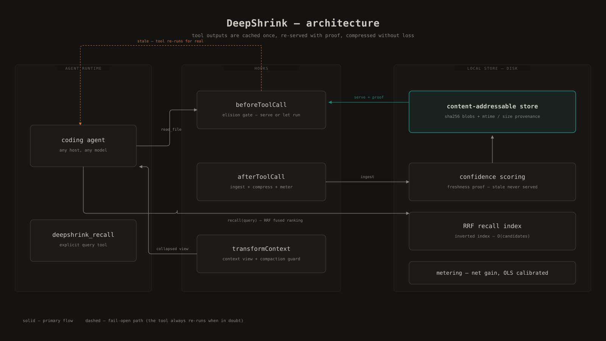

<p align="center">
  <picture>
    <source media="(prefers-color-scheme: dark)" srcset="./assets/hero-dark.svg" />
    <source media="(prefers-color-scheme: light)" srcset="./assets/hero-light.svg" />
    
  </picture>
</p>

<p align="center">
  <a href="CHANGELOG.md"><picture><source media="(prefers-color-scheme: dark)" srcset="https://shieldcn.dev/badge/deepshrink-v1.1.2-24837b.svg?variant=outline" /><source media="(prefers-color-scheme: light)" srcset="https://shieldcn.dev/badge/deepshrink-v1.1.2-19615b.svg" /></picture></a>
  <a href="https://github.com/Azertyuiop442/deepshrink"><picture><source media="(prefers-color-scheme: dark)" srcset="https://shieldcn.dev/github/stars/Azertyuiop442/deepshrink.svg?variant=outline" /><source media="(prefers-color-scheme: light)" srcset="https://shieldcn.dev/github/stars/Azertyuiop442/deepshrink.svg?color=1f2328" /></picture></a>
  <a href="#02-architecture--guarantees"><picture><source media="(prefers-color-scheme: dark)" srcset="https://shieldcn.dev/badge/runtime-100%25_local-24837b.svg?variant=outline" /><source media="(prefers-color-scheme: light)" srcset="https://shieldcn.dev/badge/runtime-100%25_local-19615b.svg" /></picture></a>
  <a href="LICENSE"><picture><source media="(prefers-color-scheme: dark)" srcset="https://shieldcn.dev/badge/license-AGPL--3.0-24837b.svg?variant=outline" /><source media="(prefers-color-scheme: light)" srcset="https://shieldcn.dev/badge/license-AGPL--3.0-19615b.svg" /></picture></a>
</p>

> **"Compression never changes the meaning."**

DeepShrink is a context-compression engine for coding agents. Tool outputs (file reads, greps, commands) are cached in a content-addressable store and re-served with proof they are still valid. Savings on tool-output tokens: ~80% on the bundled realistic mix (-91% on API JSON, -29% on `git status`) — reproduce it with `node bench/run.mjs`.

The core constraint: a compressed output must never mean anything different from the original. `"The hook must not suppress errors"` must never become `"The hook must suppress errors"`, whatever the token cost of preserving it.

---

<a id="01-why-naive-caching-fails"></a>
<p align="left">
  <picture>
    <source media="(prefers-color-scheme: dark)" srcset="./assets/div-01-dark.svg" />
    <source media="(prefers-color-scheme: light)" srcset="./assets/div-01-light.svg" />
    
  </picture>
</p>

A naive cache answers *"I have seen this read before"* and returns the stub. Three failure modes, all observed in the wild:

1. The file changed since the cached read. The model reasons over stale content with no way to know.
2. The stub replaces content the model no longer has in context (post-compaction). It believes it has read what it has not.
3. The compression itself inverts meaning: dropping `"not"` saves 1 token and inverts the instruction. The resulting repair loop costs more than the token saved.

DeepShrink addresses each one structurally, not statistically.

<details>
<summary><b>Comparison with existing approaches</b> — full write-up in <a href="DIFFERENTIATION.md">DIFFERENTIATION.md</a></summary>
<div align="left">
<br/>

An agent's bill is `O(reads)`, not `O(edits)`. Existing approaches, and what they leave on the table:

| Approach | What it does | What it does not do |
|---|---|---|
| Prompt caching (provider API) | Reuses the already-billed prefix within the same session | Does not reduce volume: the model still re-reads everything in context. Useless cross-session. |
| Anti-reread hooks (tutorials) | Intercepts a previously-seen read, returns a short stub | Exact-key cache without freshness proof. No persistent store, no recall, no metrics. |
| Persistent agent memories | Multi-layer memory for reasoning | Not a tool-output cache. No staleness detection, no elision, no fidelity guarantee. |
| Context compaction | Summarizes history when context overflows | Destructive: the original tool output is gone. DeepShrink is lossless (everything stays recallable) and acts before compaction. |
| Model handoff (prewalk) | Frontier model plans, cheap model executes | Moves reads to a cheaper model, does not eliminate them. Orthogonal: the two combine. |

</div>
</details>

---

<a id="02-architecture--guarantees"></a>
<p align="left">
  <picture>
    <source media="(prefers-color-scheme: dark)" srcset="./assets/div-02-dark.svg" />
    <source media="(prefers-color-scheme: light)" srcset="./assets/div-02-light.svg" />
    
  </picture>
</p>

<p align="center">
  
</p>

Tool outputs enter through the host's hooks. `afterToolCall` ingests each output into the content-addressable store with `mtime + size + ctime` provenance. On the next identical `read_file`, `beforeToolCall` asks the confidence scorer: proof still valid means the stored content is served and the original command never actually runs (the call is rewritten to a no-op); anything stale means the tool re-runs for real. `transformContext` keeps the context view lossless across compactions, and the meter reports the session net gain (savings minus injected overhead) in `/deepshrink stats`.

### What it compresses

- **API JSON**: repetitive arrays become compact tables (`[N=12]{id:int,name:str}` + CSV), up to `-90%`.
- **Stack traces**: keeps the error and application frames, folds runtime frames (`[... N frames collapsed]`).
- **Grep results**: grouped per file with counts (`[Search results: N matches in M files]`).
- **`git status`**: compact modified-file lists (names always kept).
- **Large texts**: keeps salient segments (errors, negations, URLs, versions, dates, amounts, hashes), drops filler.
- **Prose**: drops filler words in `fr/en/es/de`, preserves negations and content words.

<details>
<summary><b>Guarantees</b> — <code>ctime</code> kernel proof, structural negation lock, OLS metering</summary>
<div align="left">
<br/>

| Guarantee | Mechanism |
|---|---|
| Meaning never changes | Negation words (`ne/pas/jamais/not/never/nicht/kein...`) are structurally impossible to drop, and errors are never hidden. When large texts are crushed, URLs, dates, versions, hashes, amounts (units/currency) and identifiers are force-kept whatever the token cost — the full text stays recallable. |
| Freshness is proven | `read_file` blobs are re-verified by `mtime + size + ctime` at serve time.\* Identical: serve. Different: score drops by 60 and the blob is never served as content. Web and git results get their own volatility policies and time decay. |
| Stale content is never served | A blob below the stale threshold (`score < 40`) returns as a hint (reference + reason, no content). Tool elision (`beforeToolCall`) lets the real tool run. |
| Zero information loss | Every tool output is stored in full (`sha256` content-addressable store) and recoverable via `deepshrink_recall` with a confidence score. The store persists across sessions and is bounded (48 MB / 9k blobs by default, configurable): the oldest non-active blobs are evicted only when a cap is exceeded, with a 30-minute freshness floor (a forced GC ignores it). |
| Measured, not assumed | Every compression must produce a strictly smaller output, and a tool elision ships only when the replacement (reference + served slice) is smaller than the content it replaces — otherwise the tool runs for real. The chars-per-token estimator self-calibrates on real API usage events (OLS fit, ASCII and CJK priced separately). |
| Multi-language | English, French, Spanish, German, accent-normalized (`décision` = `decision`), selectable in the config (`language`). |
| 100% local runtime, zero dependencies | Pure TypeScript. No binaries, no ML libraries, no telemetry. The only outbound request refreshes the public model-pricing grid (used to price tokens and report net gains) — no content ever leaves your machine. |

<sub>\* Part of the freshness proof since v1.1.2: <code>ctime</code> is set by the kernel and cannot be set from userland (<code>utimes</code>, <code>touch -r</code>).</sub>

</div>
</details>

---

<a id="03-benchmarks--animated-pipeline"></a>
<p align="left">
  <picture>
    <source media="(prefers-color-scheme: dark)" srcset="./assets/div-03-dark.svg" />
    <source media="(prefers-color-scheme: light)" srcset="./assets/div-03-light.svg" />
    
  </picture>
</p>

<details>
<summary><b>The numbers &amp; animated pipeline (GIFs)</b> — ~80% average savings (<code>node bench/run.mjs</code>)</summary>
<div align="left">
<br/>

### The numbers

Reproduce them: `node bench/run.mjs` — bundled corpus, real pipeline, no network.
Protocol, per-version before/after tables and reproduction commands: [STATS.md](./STATS.md).

- **~80%** average savings on the bundled realistic mix (`-79.5%` overall across JSON, grep, logs, stack traces, git status, large texts, prose).
- **Per category**: `-91%` API JSON, `-80%` build logs, `-90%` prose, `-89%` large texts, `-59%` grep results, `-33%` stack traces, `-29%` git status.
- **Live session metering**: net token gain, cost, and re-read rate in `/deepshrink stats`.
- **Confidence & index**: every stored byte remains recallable with a confidence score (`0–100%`) and staleness detection; recall runs on an in-memory inverted index with code-aware tokenization (`O(candidates)` for multi-term and path queries; single-term regex queries fall back to a full scan; counters visible in `/deepshrink status`).

### How it works (animated)

| Episode | Visual | What it shows |
|---|---|---|
| **Proven Freshness** |  | Every cached blob is re-verified by `mtime + size + ctime`. Stale content is never served. |
| **Delta Ratio** |  | A changed file is re-served as a Myers-diff patch (`<= 40%` changed) instead of the whole file. |
| **RRF Fuse** |  | Recall ranking: the blob both query signals agree on wins. |
| **Net Gain** |  | The meter is calibrated on the real API bill. A tool elision ships only if the replacement is cheaper than the content it replaces; every compression must be strictly smaller. |
| **Negation Guard** |  | Negations are structurally undeletable. Compression can never invert meaning. |

</div>
</details>

---

<a id="04-installation--mcp"></a>
<p align="left">
  <picture>
    <source media="(prefers-color-scheme: dark)" srcset="./assets/div-04-dark.svg" />
    <source media="(prefers-color-scheme: light)" srcset="./assets/div-04-light.svg" />
    
  </picture>
</p>

Works in Command Code, Claude Code, Cursor, Antigravity, or any MCP client — one local store, several hosts:

<details>
<summary><b>Command Code</b> — official install (user scope, loads on every session)</summary>
<div align="left">
<br/>

```bash
cmd mods add deepshrink -g
```

Alternative source (same package, straight from GitHub): `cmd mods add Azertyuiop442/deepshrink -g`.

Restart your Command Code session, then verify with `/deepshrink status`.

Manual fallback:

```bash
# macOS / Linux
git clone https://github.com/Azertyuiop442/deepshrink.git
cd deepshrink
bash install.sh
```

```powershell
# Windows (PowerShell)
git clone https://github.com/Azertyuiop442/deepshrink.git
cd deepshrink
powershell -ExecutionPolicy Bypass -File install.ps1
```

The installer copies only the runtime files (`core/`, `runtime/`, `entry/`, `package.json`) into `~/.commandcode/mods/deepshrink`. Assets, tests and docs stay out of your machine: they are useless at runtime.

</div>
</details>

### Use with Claude Code, Cursor, or any MCP client

The same local store is served over MCP (stdio, read-only) by `scripts/mcp-server.mjs`: recall and symbol tools with the same freshness proof (stale files are never served as content, only reported).

```bash
claude mcp add deepshrink node /path/to/deepshrink/scripts/mcp-server.mjs
```

Environment variables:

- `DEEPSHRINK_DATA_DIR` — store directory (default: `~/.deepshrink` if it exists, else the mod's `data/deepshrink` folder).
- `DEEPSHRINK_WORKSPACE` — workspace used to filter stored entries (default: current directory).

<details>
<summary><b>Antigravity</b> — plugin with agent skill and MCP server</summary>
<div align="left">
<br/>

[`adapters/antigravity/`](./adapters/antigravity) is a self-contained plugin: the plugin manifest, the `deepshrink` agent skill, and an MCP server exposing `deepshrink_recall` and `deepshrink_symbol` from the same local store, with the same freshness proof (stale files are never served as content). Copy the folder into your Antigravity plugins directory, or register `adapters/antigravity/mcp-server.mjs` as a stdio MCP server.

</div>
</details>

---

<a id="05-commands--fail-open-internals"></a>
<p align="left">
  <picture>
    <source media="(prefers-color-scheme: dark)" srcset="./assets/div-05-dark.svg" />
    <source media="(prefers-color-scheme: light)" srcset="./assets/div-05-light.svg" />
    
  </picture>
</p>

<details>
<summary><b>CLI commands, fail-open rules &amp; engineering notes</b> — full reference</summary>
<div align="left">
<br/>

### Commands

```
/deepshrink            Main menu (status, stats, recall, store, config, clean...)
/deepshrink on|off     Enable / disable compression
/deepshrink recall     Search stored content (regex + confidence)
/deepshrink stats      Real savings (net token gain)
/deepshrink clean      Purge the store (workspace or everything)
/deepshrink-log        Detailed compression logs
```

### Fail-open rules

- Any doubt: keep the original.
- Output below threshold: untouched.
- Tool elision with a net `<= 0` replacement (the note is not smaller than the content): the tool runs for real.
- Prose compression saving `< 10%`: discarded.
- Errors are never hidden, always shown to the model.
- Observation masking never touches errors, error-flagged results, the first observation, small outputs or the last N outputs; masked text stays recoverable (blob ref or recall).
- Credentials are redacted before anything is stored.

### Engineering notes (post-compaction fidelity guard, rolling-hash debt)

- **Post-compaction fidelity guard**: re-reads of unchanged files are elided to a short stub, but only while the model still has the content in context. After a compaction boundary (`compaction_start` event or a new summary in `transformContext`) an epoch counter increments; a blob is stub-eligible only if re-served since the last boundary (`servedSinceEpoch[hash] === epoch`, LRU ~256). The first re-read after compaction is always served for real (~24K fidelity budget, bypassing the 2 KB recall budget), then elision resumes. Telemetry: `fidelityServes`, `stubServes`, `postCompactionStubs` (must stay `0`), `recallCalls` in `metrics.json` and `/deepshrink status`. Bootstrap note: numeric-only (~400 chars, filename allowlist, no raw content), injected once per session via `appendCustomMessageEntry`. `compactGuard` is ON by default.
- **Shrink detection**: the same epoch guard also arms deterministically when the incoming transcript shrinks (a drop of more than 20k chars and more than 10% versus the largest size seen this session), so harness trim tiers, the trim fallback of default compact mode, and rewind boundaries are covered even when no compaction event fires (`epoch-bump` with `source: shrink`).
- **Delta serve**: a re-read whose content changed is served as a Myers patch only when the previous version was re-served since the last compaction boundary (the same stub-safety gate) and the change is `<= 40%` — the new version is ingested regardless, so later reads serve it for real. Windowed re-reads run through the same diff; `/deepshrink status` reports delta serves and refusal reasons (`no prior`, `stub-unsafe`, `ratio`, `oversize`, `patch`, `window`). Known limit: windowed output without compaction (`"seen = still in context"`) remains an unverifiable-by-hook heuristic.
- **Observation masking**: tool outputs older than the last N (default `8`) are replaced with a recoverable placeholder keeping line/char counts and blob ref. The cut moves at most every `polling` observations (default `4`), keeping the prompt prefix byte-stable between moves; deterministic, no LLM, errors and small outputs exempt (`mask:` in `/deepshrink status`).
- **Symbol retrieval**: the `deepshrink_symbol` tool serves one named definition (function, class, struct, ...) with its body and line range from the store with the same freshness proof — changed files on disk are reported as stale candidates rather than served as definitions.
- **Context pressure**: `/deepshrink status` adds a deterministic reading (growth per turn, cache ratio, turns since compaction) with advice when the context needs attention; the dashboard bridge exposes a live segment with growth per turn and masked volume.
- **Awareness**: while enabled, the harness re-injects a one-line hint (`appendSystemPrompt`) on every request so store tools remain visible even after compaction.
- **Cache-prefix identity**: every turn the executor hashes the frozen region (up to the last mask placeholder) and compares it with the previous turn's hash. One sanctioned advance per polling boundary is counted as `prefix cuts`; any unexpected rewrite raises a `prefix-rewrite` warning and increments `frozenRewriteRefusals`.
- **Project playbook**: deterministic per-project list of actually-served files injected into the compaction state summary (`/deepshrink playbook` to view, `reset` to clear; capped, eviction-sorted, no LLM).
- **Cross-CLI store**: `scripts/mcp-server.mjs` serves the same local store over MCP (stdio) to any MCP client — read-only recall and symbol tools with the same freshness proof, configured via `DEEPSHRINK_DATA_DIR`.

</div>
</details>

---

<h2 align="center">License</h2>

<p align="center">
  <a href="LICENSE">AGPL-3.0</a> — any fork or redistribution (including as a network service) must republish modified source under AGPL-3.0 and retain attribution notices. Commercial license available on request.<br/>
  Issues and pull requests welcome — see <a href="CONTRIBUTING.md">CONTRIBUTING.md</a>.
</p>

---

<h3 align="center">Want to leave feedback?</h3>

<p align="center">
  <a href="https://peership.dev">
    <picture>
      <source media="(prefers-color-scheme: dark)" srcset="./assets/peership-dark.svg" />
      <source media="(prefers-color-scheme: light)" srcset="./assets/peership-light.svg" />
      
    </picture>
  </a>
</p>

<p align="center">
  <a href="https://x.com/astra442">
    <picture>
      <source media="(prefers-color-scheme: dark)" srcset="https://shieldcn.dev/badge/Follow%20%7C-@astra442-FFFFFF.svg?logo=x&variant=outline" />
      <source media="(prefers-color-scheme: light)" srcset="https://shieldcn.dev/badge/Follow%20%7C-@astra442-1f2328.svg?logo=x" />
      
    </picture>
  </a>
</p>
